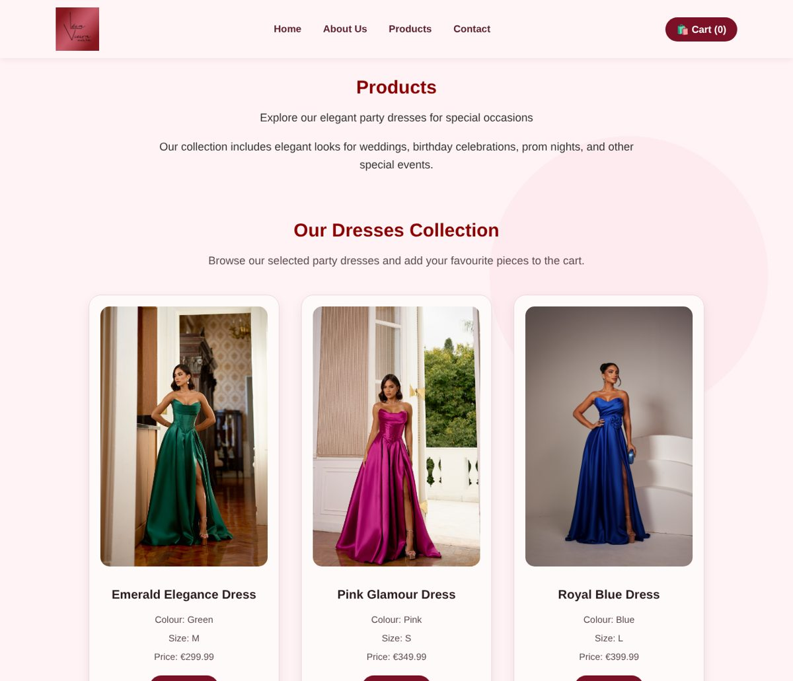
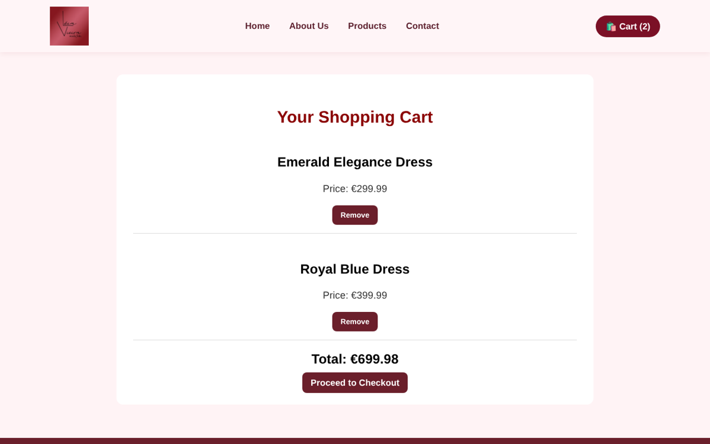
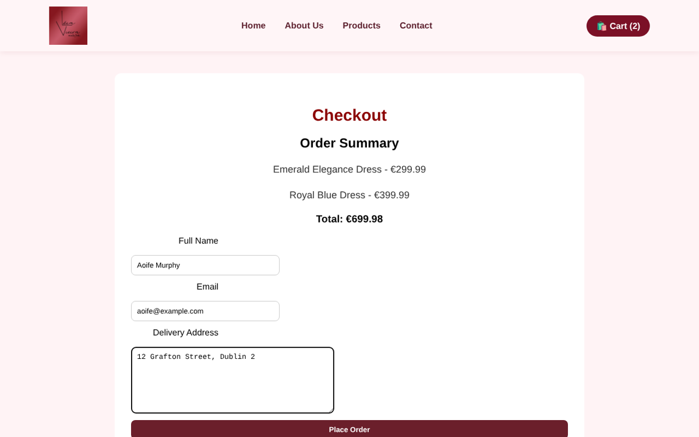
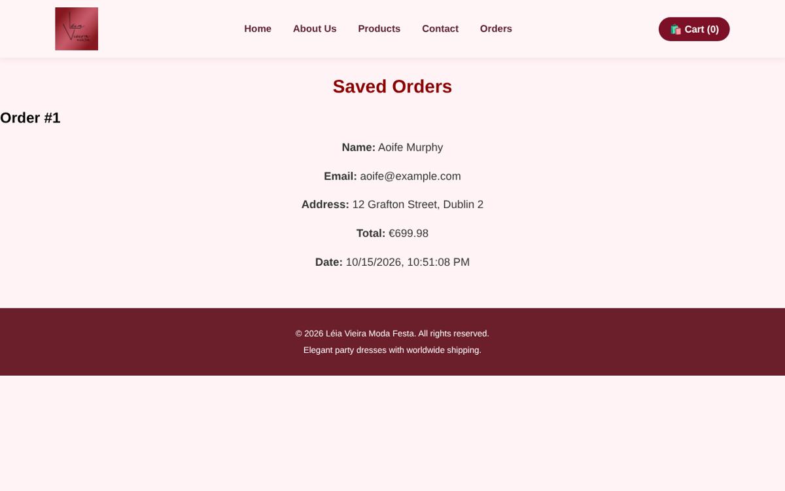

# LV Moda Festa – Online Store Prototype

A small e-commerce website for **Léia Vieira Moda Festa**, a real Brazilian boutique of party dresses. I built it for the Web Development module of my HDip in Computing at CCT College Dublin (May 2026).

This is a **first, basic version**: a prototype of how the online store could work. The real store's website will keep changing, and I'll update this repository as I improve it.



## What it does

- Loads the dresses from a **MySQL** database and shows them on the products page
- Lets the customer add dresses to a **cart** (kept in the browser with `localStorage`) and remove them
- **Checkout** form that saves the order in the database
- **Orders** page that lists the saved orders
- Contact form with validation in JavaScript

Built with **HTML, CSS, JavaScript, Node.js (Express) and MySQL**.

| Cart | Checkout | Saved orders |
|---|---|---|
|  |  |  |

## Running it

Needs Node.js and MySQL.

1. Create the database by running `database_setup.sql` in MySQL.
2. Copy `.env.example` to `.env` and add your MySQL password.
3. Install and start:

```
npm install
npm start
```

Then open http://localhost:3000.

## Next steps

- Product sizes and colours to choose from, instead of one fixed option per dress
- Admin page to add and edit dresses
- Real payments, and publishing the site online
